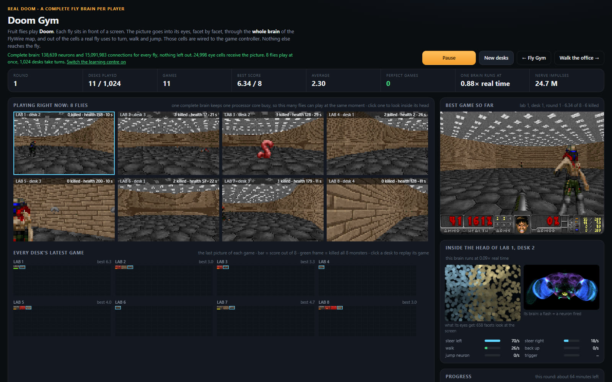

# AI Fruit Fly

A real fruit fly brain (all 138,639 neurons of the FlyWire map) simulated live in the browser.

- **Fly world** (`ai-fly/index.html`): a 3D fly whose whole brain steers it. It finds food, escapes a swatter and grooms.
- **Döner Dev Fly** (`ai-fly/doener.html`): the fly's learning centre picks code blocks by smell and learns from sugar and bitter until it has written a rotating döner kebab web app.
- **Fly Gym** (`ai-fly/fly-gym.html`): hard mode. 1,024 flies, each with its own copy of the learning centre, type a three.js döner app one token at a time and train together in 8 parallel labs.
- **Cubicles** (`ai-fly/cubicles.html`): the Fly Gym as an office you walk around in (WASD). 1,024 flies type at 1,024 desks, the supervisor deck has a live wall screen and push buttons for the speed, and the first fly to write a perfect döner gets a party, a path on the floor to its desk, a sugar cube and a management contract. It can record itself into one video: [media/cubicles-demo.mp4](media/cubicles-demo.mp4) (83 s, one smooth take at 1920×1080, recorded frame by frame by the page itself with `?autopilot&record`) shows a full run, with the first perfect döner in round 131, and ends with the winner's döner app running in real three.js.
- **Doom Gym** (`ai-fly/doom-gym.html`): the flies play Doom. It is the real Doom engine (its open-source release) with the free Freedoom data. The picture goes into the fly's eyes, facet by facet, through the **complete brain** (all 138,639 neurons, nothing left out or changed) and out of the cells a real fly uses to turn, walk and jump, which are wired to the game controller. Nothing else reaches the fly. A complete brain keeps one processor core busy, so on an 8-core computer 8 flies play at the same moment and the 1,024 desks take turns. Add `?fast` for a reduced brain that is quicker and not the real thing.
- **Doom Cubicles** (`ai-fly/doom-cubicles.html`): the Doom Gym as the walkable office. Every monitor shows that desk's game, a blue marker floats over the desks that are playing right now, and the supervisor deck shows the live games and the best game so far.




In the first measured run with complete brains (64 desks), the average fly killed about 2 of the 8 monsters in round 1 and about 4 in round 3, and one fly killed all 8. The brain is the same in every game; only the desk's setup differs (screen size, how strongly the picture drives the eye cells, how the fly's movements are read). By default the flies do not learn Doom with sugar and bitter, because nothing from the screen reaches the learning centre. With `?learn` blue light on the screen reaches a few dozen of its cells and kills earn sugar and hits bitter; that works as it does in a real fly, and in our tests it did not make the flies better (4.02 of 8 with learning, 4.28 without, 4.25 with the learning centre off), so it stays off by default. Details in [ai-fly/README.md](ai-fly/README.md).

**Demo video:** [media/fly-gym-demo.mp4](media/fly-gym-demo.mp4) (59 s). It shows a full Fly Gym run with 1,024 flies, from random typing to the first perfect döner in generation 219 (2 minutes 16 seconds of training, recorded in one take), and then the app the flies wrote: a tall, slim döner on a spit, a glowing grill behind it, and the shaved meat landing on a dürüm ([ai-fly/examples/doener-by-1024-flies.html](ai-fly/examples/doener-by-1024-flies.html), add `?side` for a side view).
Getting there took a few rounds of closing loopholes. The flies' first "döner" passed every test as a giant glowing ball swallowing the meat ([first-try-glowing-ball.html](ai-fly/examples/first-try-glowing-ball.html)), and the winner of the first video looked like a lampshade on a loaf ([lampshade-by-1024-flies.html](ai-fly/examples/lampshade-by-1024-flies.html)). That's a classic case of a learner gaming its reward; the details are in [ai-fly/README.md](ai-fly/README.md).

Run it:

```bash
cd ai-fly
python serve.py
```

Then open <http://127.0.0.1:8765>. See [ai-fly/README.md](ai-fly/README.md) for details, credits and licences.
The FlyWire data is CC BY-NC 4.0: non-commercial use only, with credit.
