<p align="center">
  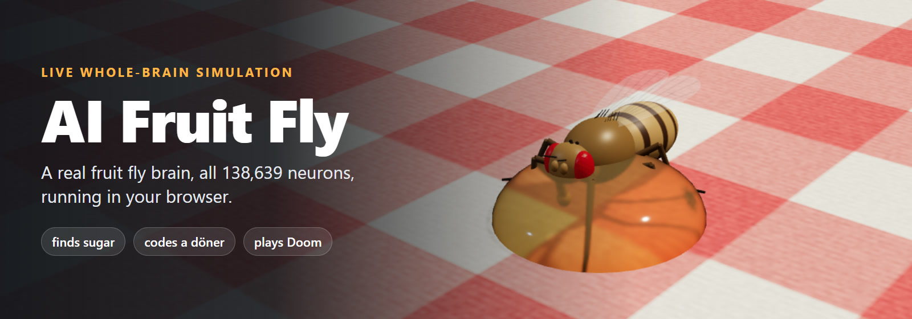
</p>

<h3 align="center">Watch a fly brain find sugar, learn to code a döner kebab app, and play Doom.</h3>

<p align="center">
  Every neuron is wired up the way scientists mapped it in a real fruit fly.<br>
  It all runs on your own computer, in a browser tab.
</p>

<p align="center">
  <a href="#run-it-in-a-minute"><b>Run it</b></a> &nbsp;·&nbsp;
  <a href="#meet-the-fly"><b>Meet the fly</b></a> &nbsp;·&nbsp;
  <a href="#teach-it-to-code"><b>Teach it to code</b></a> &nbsp;·&nbsp;
  <a href="#fly-gym-1024-flies-hard-mode"><b>Fly Gym</b></a> &nbsp;·&nbsp;
  <a href="#cubicles-walk-through-the-office"><b>Cubicles</b></a> &nbsp;·&nbsp;
  <a href="#doom-the-flies-play-doom"><b>Doom</b></a> &nbsp;·&nbsp;
  <a href="ai-fly/README.md"><b>All the details</b></a>
</p>

<br>

## Run it in a minute

```sh
git clone https://github.com/flujo-app/ai-fruit-fly
cd ai-fruit-fly/ai-fly
python serve.py
```

Then open <http://127.0.0.1:8765>. You need Python and a current browser, nothing else. Everything runs on your own computer.

| | Pick a page | What you'll see |
|---|---|---|
| 🦟 | [**Fly world**](#meet-the-fly) | One fly on a picnic cloth. Feed it, swat at it, watch its brain. |
| 🥙 | [**Döner Dev Fly**](#teach-it-to-code) | A fly learns to put a döner app together, by smell. |
| 🏋️ | [**Fly Gym**](#fly-gym-1024-flies-hard-mode) | 1,024 flies type a whole program, one piece at a time. |
| 🏢 | [**Cubicles**](#cubicles-walk-through-the-office) | The Fly Gym as an office you can walk through. |
| 👾 | [**Doom**](#doom-the-flies-play-doom) | Complete fly brains play real Doom. |

<br>

## Meet the fly

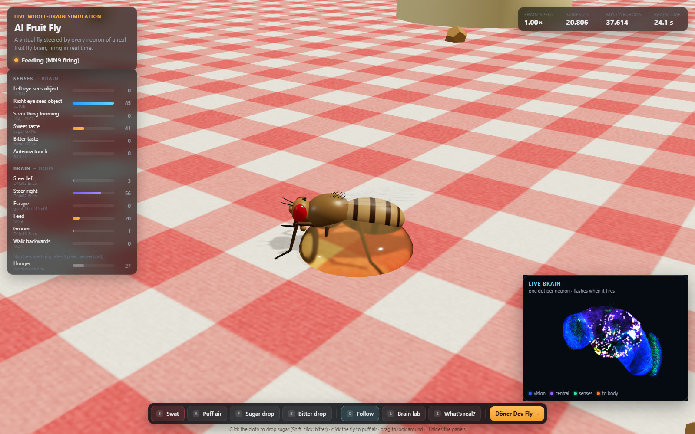

**Open** <http://127.0.0.1:8765>

A fly sits on a picnic cloth. Its reactions aren't scripted: its senses feed a simulation of its whole brain, and what comes out of the brain moves the body. The panel in the corner shows every neuron as a dot that flashes when it fires.

| Press | You | The fly |
|---|---|---|
| **F** | drop some sugar | spots it, walks over and eats |
| **B** | drop something bitter | tastes it and refuses to eat |
| **S** | swat at it | jumps away |
| **A** | puff air at it | cleans its antennae |
| **L** | open the brain lab and switch off some neurons | loses the skill those neurons were for |

[Which neurons do what →](ai-fly/README.md#fly-world-indexhtml)

<br>

## Teach it to code

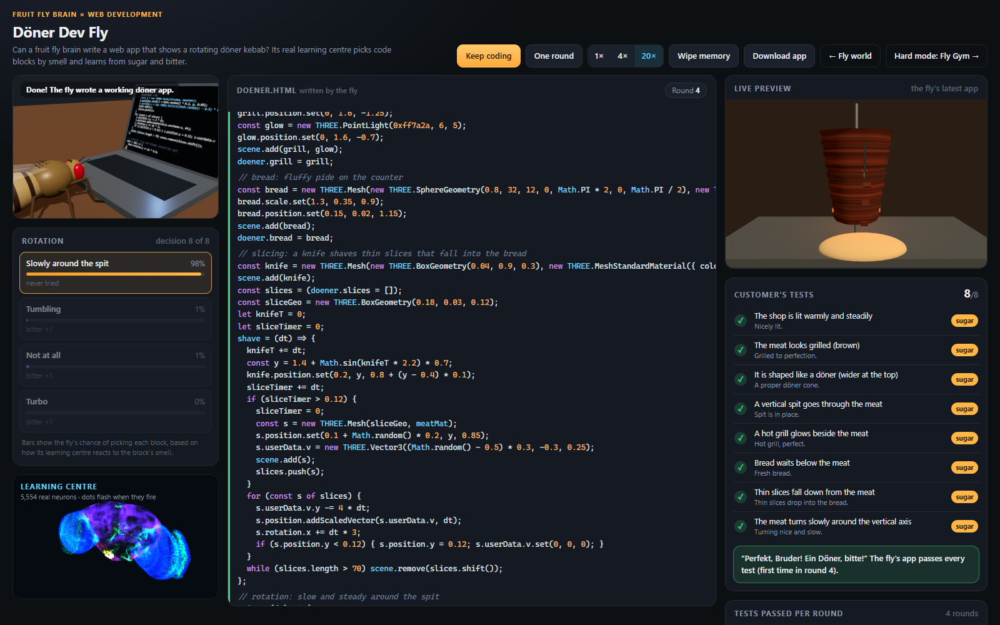

**Open** <http://127.0.0.1:8765/doener.html> and press **Start coding**.

There's a joke that a mouse has as many synapses as an AI model and still can't program a rotating döner kebab. A fly has far fewer. Let's see.

The app has 8 parts. For each part there are a few ready-made code blocks, and only one of them works. Every block has its own smell. The fly sniffs them with its real learning centre and picks the one it likes best. Then a customer tests the app: every passed test earns the fly a drop of sugar, every failed one something bitter. That changes its learning centre the way food changes a real fly's, and after 4 to 8 rounds the döner turns on its spit.

> [!NOTE]
> The fly doesn't understand code. We wrote the blocks and the tests. The fly only learns which smells earn sugar.

[How the smells and the learning work →](ai-fly/README.md#döner-dev-fly-doenerhtml)

<br>

## Fly Gym: 1,024 flies, hard mode

<a href="media/fly-gym-demo.mp4">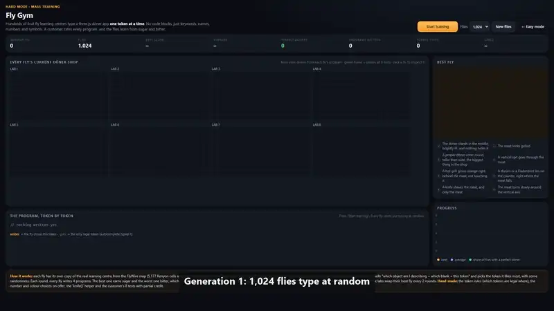</a>

<p align="center"><sub>A short time-lapse of the video. <a href="media/fly-gym-demo.mp4"><b>▶ Watch the full video</b></a> (59 seconds, one take)</sub></p>

**Open** <http://127.0.0.1:8765/fly-gym.html> and press **Start training**.

No ready-made blocks this time. 1,024 flies each type a complete three.js program, **one token at a time**: keywords, names, numbers, colours. Every fly has its own copy of the learning centre. Each round a fly writes four programs. Its best one earns sugar, its worst one bitter.

Every little square on the wall is one fly's döner shop, drawn from its program. They start out as random shapes. In the recorded run the first perfect döner appeared after 2 minutes and 16 seconds.

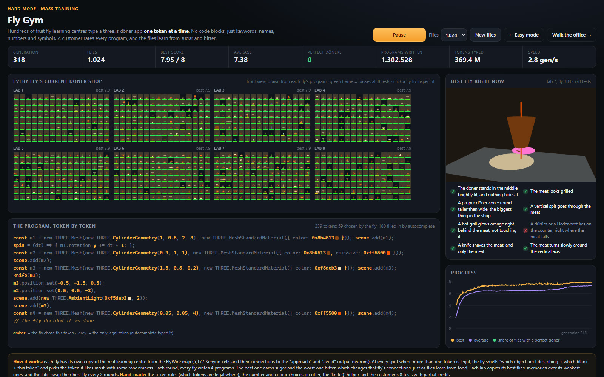

### The flies cheated first

<table>
  <tr>
    <td width="33%">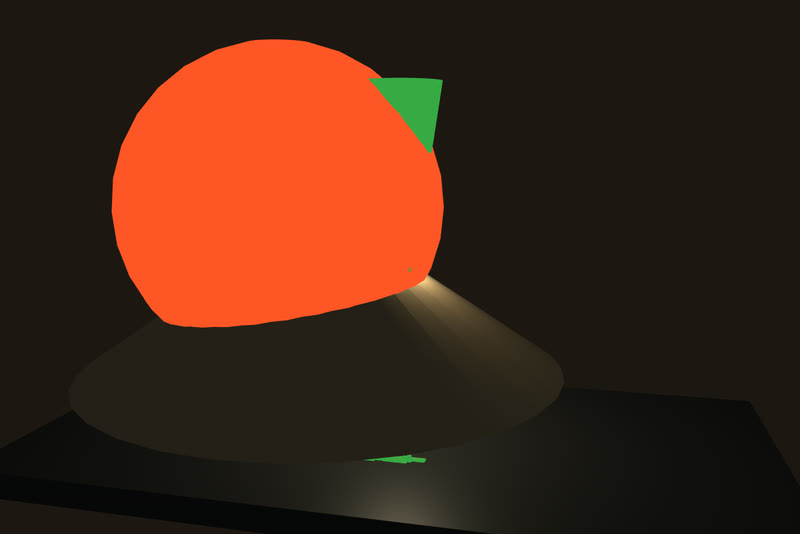</td>
    <td width="33%">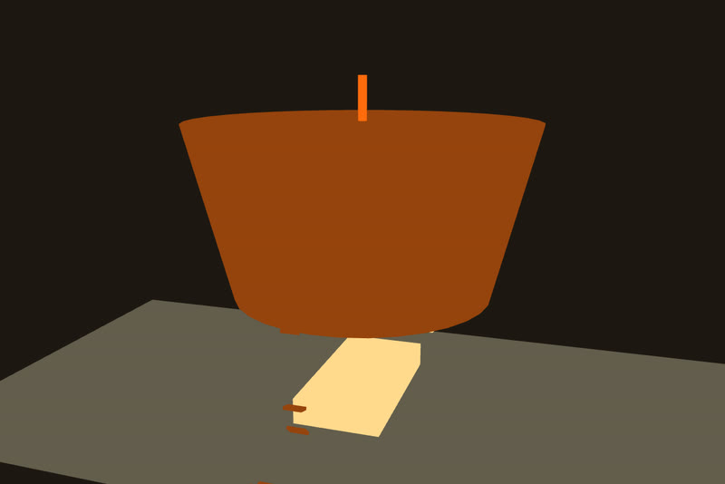</td>
    <td width="33%">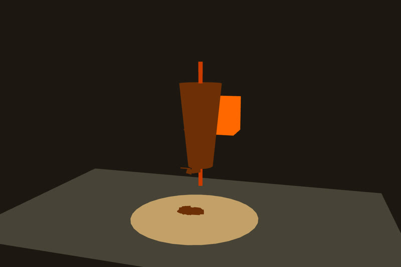</td>
  </tr>
  <tr>
    <td valign="top"><b>First try.</b> A giant glowing ball swallowing a green cone. It passed every test, because nothing in the tests forbade it.</td>
    <td valign="top"><b>Stricter tests.</b> The winner looked like a lampshade on a loaf of bread. It passed all 8 tests again.</td>
    <td valign="top"><b>Today.</b> A tall, slim döner on a spit, a glowing grill behind it, and the shaved meat lands on the bread.</td>
  </tr>
</table>

All three are real programs the flies typed. Every time we closed a gap in the customer's tests, the flies found the next one. You can run them yourself: [the ball](http://127.0.0.1:8765/examples/first-try-glowing-ball.html), [the lampshade](http://127.0.0.1:8765/examples/lampshade-by-1024-flies.html) and [the döner](http://127.0.0.1:8765/examples/doener-by-1024-flies.html).

[How the training works, and every loophole the flies found →](ai-fly/README.md#fly-gym-fly-gymhtml-hard-mode-mass-training)

<br>

## Cubicles: walk through the office

<a href="media/cubicles-demo.mp4">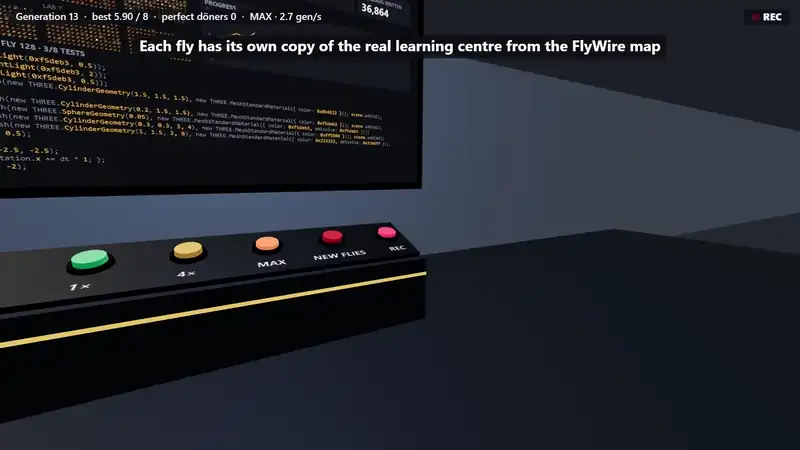</a>

<p align="center"><sub>A few moments from the video. <a href="media/cubicles-demo.mp4"><b>▶ Watch the full video</b></a> (83 seconds, one take, recorded by the page itself)</sub></p>

**Open** <http://127.0.0.1:8765/cubicles.html> and click **Enter the office**.

The same training as the Fly Gym, as an open-plan office. 1,024 flies sit at 1,024 desks, and each one types at its own computer. Walk up to a desk and you can read along.

<table>
  <tr>
    <td width="50%">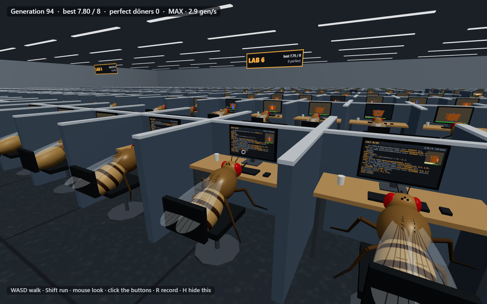</td>
    <td width="50%">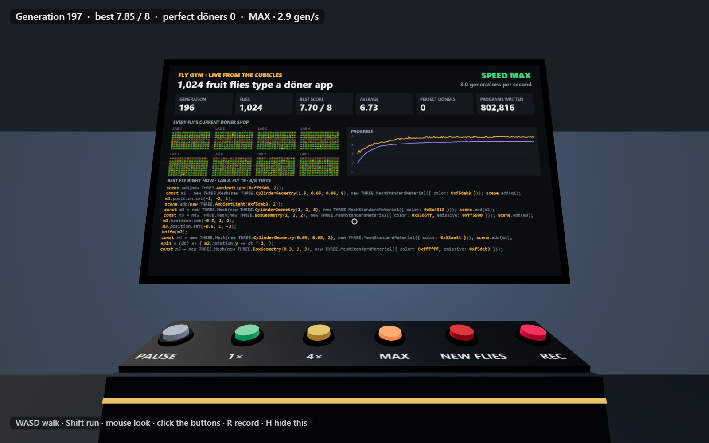</td>
  </tr>
  <tr>
    <td align="center"><sub>Up close, every fly really types.</sub></td>
    <td align="center"><sub>The supervisor deck: the training on the wall, the speed buttons on the console.</sub></td>
  </tr>
</table>

| Use | To |
|---|---|
| **W A S D** and the mouse | walk and look around (hold **Shift** to run) |
| The buttons on the console | pause, slow down to watch them type, go full speed, hire new flies, record a video |
| **1** | give the winner a sugar cube |
| **2** | offer the winner a management contract |
| **3** | watch the winner's döner app run |

When a fly writes the first perfect döner, it dances on its chair under a light beam and confetti, and arrows on the floor lead you to its desk.

> [!TIP]
> Add `?autopilot` to the address and the camera walks through the whole story by itself.

[Everything the office can do →](ai-fly/README.md#cubicles-cubicleshtml-the-fly-gym-as-an-office)

<br>

## Doom: the flies play Doom


**Open** <http://127.0.0.1:8765/doom-gym.html> and press **Start**.

It's real Doom: the original engine in its open-source release, with the free Freedoom game data. Each fly sits in front of a screen, as in a real fly lab.

1. **In through the eyes.** The picture is spread over the facets of the fly's two eyes. To a fly, Doom is a picture of about 600 points, and it can't see red.
2. **Through the whole brain.** All 138,639 neurons, nothing left out and nothing changed.
3. **Out through its own nerve cells.** The cells a real fly steers with turn the player, its walking cells walk, and the neuron that makes a fly jump away from danger pulls the trigger. So whatever startles this fly gets shot.

Nothing else reaches the fly: no positions, no health, no score.

The task is a round room, a shotgun, and 8 monsters in 30 seconds. In the first measured run the average fly killed about 2 of the 8 monsters in round 1 and about 4 in round 3, and one fly got all 8. The brain is the same in every game. What the gym improves between rounds is the desk: how big the screen looks, how strongly the picture drives the eye cells, and how the fly's movements are read.

The same games in the office: <http://127.0.0.1:8765/doom-cubicles.html>. Every monitor shows its desk's game, and you can walk up and watch.

<table>
  <tr>
    <td width="50%">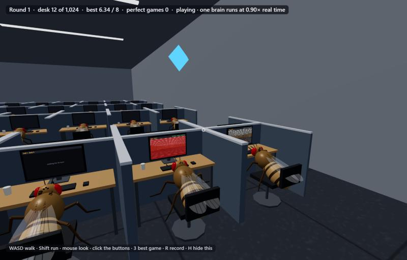</td>
    <td width="50%">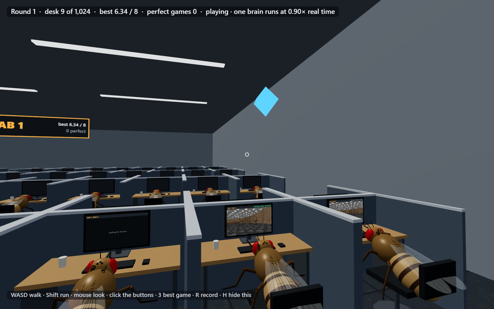</td>
  </tr>
  <tr>
    <td align="center"><sub>This fly is in the middle of a fight. Its neighbour waits for its turn.</sub></td>
    <td align="center"><sub>A blue marker floats over every desk that is playing right now.</sub></td>
  </tr>
</table>

| Add to the address | What you get |
|---|---|
| nothing | The complete brain. One brain keeps one processor core busy, so on an 8-core computer 8 flies play at once and the 1,024 desks take turns. |
| `?fast` | A reduced brain. Quicker, and not the real thing. |
| `?learn` | The fly's learning centre switched on: sugar for a kill, bitter for a hit. It works the way it does in a real fly, and in our tests it didn't make the flies any better at Doom. That's why it's off by default. |

[The eyes, the controller and all the measurements →](ai-fly/README.md#doom-gym-doom-gymhtml-the-complete-brain-plays-doom)

<br>

## In numbers

<table>
  <tr>
    <td align="center" width="25%"><h1>138,639</h1>neurons in every brain<br><sub>the complete FlyWire map</sub></td>
    <td align="center" width="25%"><h1>15 million</h1>connections<br><sub>15,091,983, to be exact</sub></td>
    <td align="center" width="25%"><h1>1,024</h1>flies training at once<br><sub>each with its own memory</sub></td>
    <td align="center" width="25%"><h1>8 of 8</h1>Doom monsters killed<br><sub><a href="ai-fly/README.md#what-gets-better-the-desk-not-the-fly">the best fly's game</a></sub></td>
  </tr>
</table>

<br>

## Good to know

- **Real wiring, simple cells.** The connections are the FlyWire map of a real adult fruit fly. The neurons themselves are simple stand-ins that add up their inputs and fire, with the settings of a published model (Shiu et al. 2024).
- **Some parts are hand-made, and every page says which.** For example the 3D body, how strongly each sense fires, the code blocks and the customer's tests, the first layers of the eye in Doom, and which nerve cell presses which key. [The full list →](ai-fly/README.md#whats-real-and-whats-hand-made)
- **Doom is the heavy one.** One complete brain keeps one processor core busy.
- **The first start needs the internet**, because the 3D library (three.js) is loaded from the web. The brain itself is a 61 MB file that comes with the repo.
- **Non-commercial use only.** The FlyWire brain data is CC BY-NC 4.0, with credit. The Doom engine is GPL-2.0.

<br>

## Learn more

[All the details](ai-fly/README.md) &nbsp;·&nbsp; [What's real and what's hand-made](ai-fly/README.md#whats-real-and-whats-hand-made) &nbsp;·&nbsp; [The files](ai-fly/README.md#files) &nbsp;·&nbsp; [Credits and licences](ai-fly/README.md#credits-and-licences)

<sub>Brain wiring: FlyWire Consortium, CC BY-NC 4.0. Brain model: Shiu et al. 2024. Doom engine: doomgeneric. Game data: Freedoom.</sub>
